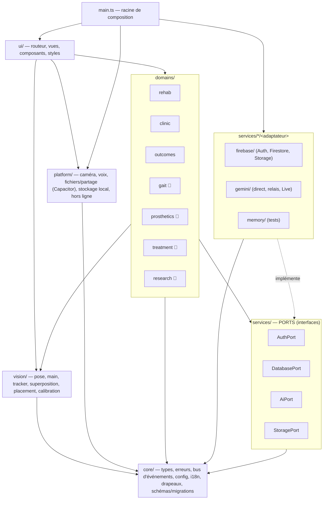
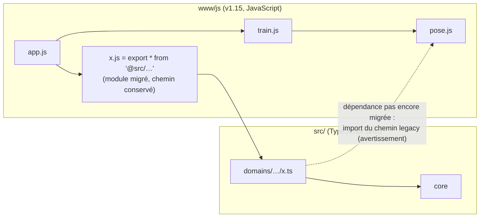
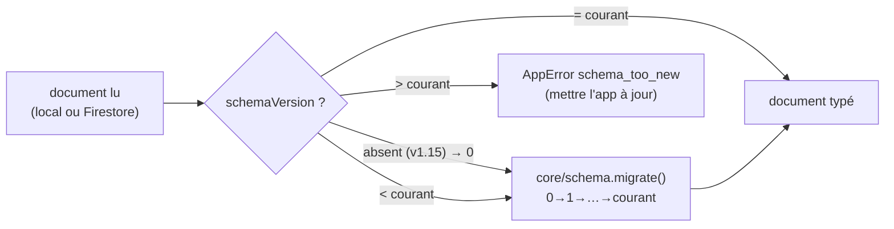
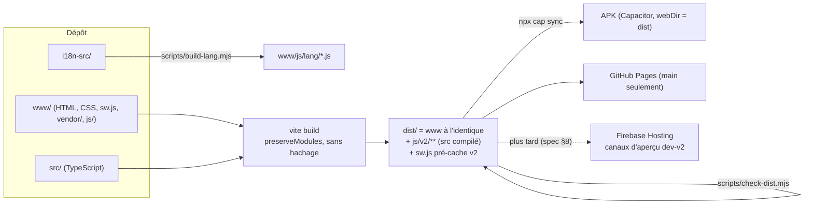

# Architecture de Mobilis v2

> Branche `dev-v2`. Spécification : [`docs/spec-v2.md`](spec-v2.md). Décisions : [`docs/adr/`](adr/). Plan de migration : [`docs/MIGRATION.md`](MIGRATION.md).

Mobilis est une application web monopage (SPA) en ES modules, empaquetée en APK Android par Capacitor. Toute la vision
(MediaPipe Pose/Hand) s'exécute **sur l'appareil** ; aucune vidéo n'est conservée ni envoyée. Firebase (Auth + Firestore)
sert aux comptes et à la synchronisation ; Gemini (direct ou relais) sert au coach vocal et aux reformulations.

La v2 introduit une architecture en couches (TypeScript strict, ports/adaptateurs) **sans réécriture globale** : le code
v1.15 (`www/js`) est remplacé fichier par fichier (stratégie « strangler », [ADR 0005](adr/0005-strangler.md)).

## 1. Couches



🚩 = derrière le drapeau `gait` (désactivé par défaut, [ADR 0006](adr/0006-drapeaux.md)).

| Couche | Rôle | Peut importer | Ne peut PAS importer |
|---|---|---|---|
| `core` | Types partagés (`Patient`, `Assessment`, `Plan`, `Study`, `Intervention`… tous avec `schemaVersion`), erreurs, bus d'événements, config, contrat i18n, drapeaux, migrations | rien (pur) | toute autre couche, toute bibliothèque |
| `platform` | Adaptateurs appareil (navigateur / Capacitor) | `core` | `domains`, `ui`, `services` |
| `services` | Ports (interfaces) + adaptateurs (Firebase, Gemini, mémoire) | `core` | `domains`, `ui` |
| `vision` | Traitement d'images sur l'appareil, géométrie, calibration | `core` | `domains`, `ui` |
| `domains/*` | Logique métier + données cliniques typées et sourcées | `core`, `vision`, **ports** de `services` | `ui`, `platform`, adaptateurs, Firebase, `domains/<autre>/internal/` |
| `ui` | Routeur, vues, composants : seule couche qui touche le DOM de l'app | tout sauf adaptateurs Firebase | `domains/*/internal/` |
| `main.ts` | Assemble adaptateurs + drapeaux + bus (injection) | tout | — |

Ces règles sont **vérifiées automatiquement** (`npm run lint:deps`, [`.dependency-cruiser.cjs`](../.dependency-cruiser.cjs)) :
`no-circular`, `domains-not-ui`, `domains-not-platform`, `domains-only-service-ports`, `domains-internal-private`,
`core-is-pure`, `lower-layers-not-up`, `firebase-only-in-adapters`, `capacitor-only-in-platform`, `new-code-not-legacy`
(avertissement pendant la migration). ESLint interdit aussi `import 'firebase…'` hors de `src/services/*/firebase/`.

## 2. Dépendances pendant la migration (strangler)



* Un fichier migré garde son chemin `www/js/x.js` sous forme de **module de réexportation** : aucun importeur ne change,
  les noms exportés sont garantis identiques par `tests/legacy-exports.spec.ts` (instantané `tests/fixtures/legacy-exports.json`).
* Le build Vite résout `@src/…` ; Node (tests v1.15) aussi grâce à `--import ./scripts/register-src-alias.mjs`
  (Node ≥ 22.18 exécute le TypeScript « effaçable » ; `erasableSyntaxOnly` est activé dans `tsconfig.json`).
* Cycles existants du legacy (à casser pendant la migration) : `state.js → rom.js → state.js` (import dynamique) et
  `calendar.js → onboarding.js → calendar.js` (import dynamique).

## 3. Flux de données

### 3.1 Séance d'exercice (existant) et évaluation de la marche (v2)

```mermaid
sequenceDiagram
  autonumber
  participant Cam as platform/camera
  participant Vis as vision (MediaPipe sur l'appareil)
  participant Dom as domains (rehab | gait)
  participant UI as ui (vue)
  participant Bus as core/events
  participant DB as DatabasePort
  participant AI as AiPort (facultatif)

  UI->>Cam: ouvrir (avant/arrière)
  loop chaque image (jamais enregistrée)
    Cam->>Vis: image
    Vis->>Dom: PoseFrame (repères normalisés, t)
  end
  Dom->>Dom: cycles / répétitions, métriques, règles sourcées
  Dom-->>UI: résultats (valeur, unité, confiance, « pourquoi », sources)
  UI->>DB: set('assessments', …) — videoRetained: false
  DB-->>Bus: assessment:saved
  opt consentement + clé ou relais
    UI->>AI: reformuler / expliquer (texte ; image seulement avec consentement)
  end
```

### 3.2 Persistance et versions de schéma



## 4. Build et déploiement



| Branche | Workflow | Résultat |
|---|---|---|
| `main` | `android.yml` | APK (artefact) ; Release publique **seulement** sur étiquette `v*` |
| `main` | `pages.yml` | Site public GitHub Pages (garde-fou : refuse toute autre branche) |
| `dev-v2`, `dev-v2-*`, PR → `dev-v2` | `ci-v2.yml` | lint, types, tests, build, parité + e2e sur `dist`, APK **debug** en artefact (7 jours) ; aucune publication, aucun secret |

> Ne jamais pousser d'étiquette `v*` depuis `dev-v2` : `android.yml` publierait une Release.

## 5. Outillage

| Commande | Rôle |
|---|---|
| `npm run dev` | Serveur Vite sur `www/` (TypeScript de `src/` transpilé à la volée) |
| `npm run build` | Langues → Vite → `dist/` → vérification (`verify:dist`) |
| `npm run typecheck` | `tsc` strict (src) ; legacy inclus sans vérification (`allowJs`, `checkJs: false`) |
| `npm run lint` | ESLint + règles d'architecture (dependency-cruiser) + Prettier (nouveau code) |
| `npm test` | Vitest : tests unitaires `src/**/*.test.ts`, adaptateur des 22 scripts v1.15, contrat des exports legacy |
| `npm run test:legacy` | Les 22 scripts v1.15 en série (ancien `npm test`) |
| `npm run test:parity` | Même texte à l'écran, route par route, entre la référence (`www/` ou `MOBILIS_BASE`) et `dist/` |
| `npm run test:e2e` / `test:e2e:dist` | Tests Playwright v1.15 sur `www/` ou sur `dist/` |
| `npm run check` | lint + types + tests + build (critère « vert » de la spec §9) |

## 6. Arborescence

```
src/
  core/        types/ (common, clinical), errors, events, flags, schema, config, i18n
  platform/    ports (KeyValueStore, Camera, Speech, Share, Connectivity), storage, flags (surcharges)
  services/    auth|db|ai|storage/{port.ts, memory/, firebase/ | gemini/}
  vision/      contrats (Landmark, PoseFrame, Calibration, PoseSource), indices de repères
  domains/     rehab, clinic, outcomes, gait, prosthetics, treatment, research (+ types.ts : DomainDescriptor)
  ui/          Route, View, routeVisible
  main.ts      createContainer() : config, bus, drapeaux, domaines actifs
```
